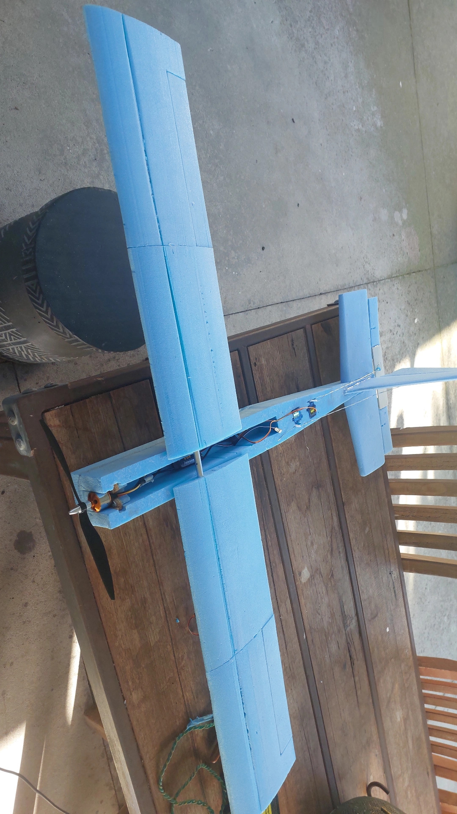
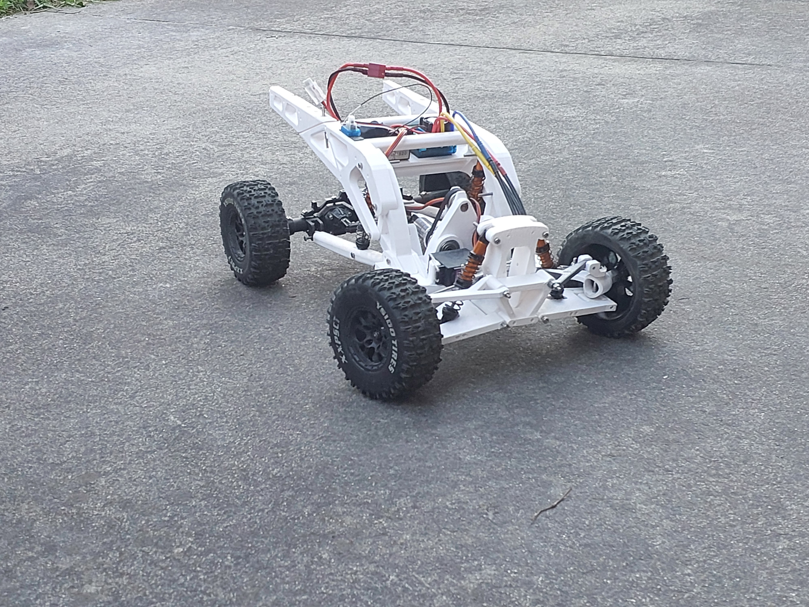

# RC Projects Portfolio

Hi, I'm Luca Plottier. I design and build radio controlled (RC) vehicles in my spare time. Each project below is a full write-up of the design, build, cost, testing and lessons learned, with photos and video. I include what went wrong as well as what worked, because the lessons are the point.

---

## Projects

### 1. RC Foam Plane

  

A 1.2 m wingspan electric foam plane, designed and built from scratch for a first-time pilot. It came in at about \$225 against a \$150 target, flew about ten short flights, and survived repeated hard landings and nose dives.

**Skills shown:** CAD, hot wire cutting, sanding and sculpting, soldering, systems integration

**[Read the full write-up →](foam_plane_v1/rc-foam-plane.md)**

---

### 2. RC Trophy Truck

  

A 1:10 scale electric trophy truck with a custom 3D printed chassis, designed around long-travel suspension: independent double wishbone at the front and a 4-link solid axle at the rear. It took about 100 hours over 6 months and about \$228 in parts. It handled gravel, grass and jumps, and taught me hard lessons about drivetrain design and unsprung weight, which I'm applying to a second version.

**Skills shown:** CAD (SolidWorks), 3D printing, iterative design, suspension design, soldering, systems integration

**[Read the full write-up →](trophy_truck_v1/rc_trophy_truck.md)**

---

## Skills across both projects

**Design and CAD**
- Modelled a full truck assembly in SolidWorks, fitting each part to the whole and fixing collisions found in prototypes
- Scaled designs from real-world dimensions, such as trophy truck proportions and propeller-to-wingspan ratios
- Iterated on parts through several versions

**Fabrication**
- 3D printing in PLA and PETG, including choosing materials for prototypes versus final parts
- Hot wire foam cutting, sanding and shaping, and metalworking with an aluminium wing spar
- Built my own tools, including a hot wire cutter powered from a LiPo charger

**Electronics**
- Soldering and wiring motors, ESCs, servos and batteries
- Setting up RC radio systems, including receiver binding and channel assignment
- Integrating brushless electric drivetrains in both a plane and a truck

**Engineering and problem solving**
- Tracing failures to their causes, such as a weak wing joint, bending control linkages, belt slip and poor print orientation
- Weighing trade-offs between options, and being honest when an assumption turned out to be wrong
- Testing in real conditions and using the results to plan the next version

**Project management**
- Planning and tracking budgets, and sourcing parts second-hand where possible
- Documenting each project from first sketch to final lessons

---

## About these write-ups

Each write-up follows a similar structure: why I built it, the design and key decisions, the build, problems and how I solved them, the cost, test results, and what I'd do differently.

## Contact

- **Email:** [LucaPlottier@gmail.com](mailto:LucaPlottier@gmail.com)
- **LinkedIn:** [linkedin.com/in/lucaplottier](https://www.linkedin.com/in/lucaplottier/)
