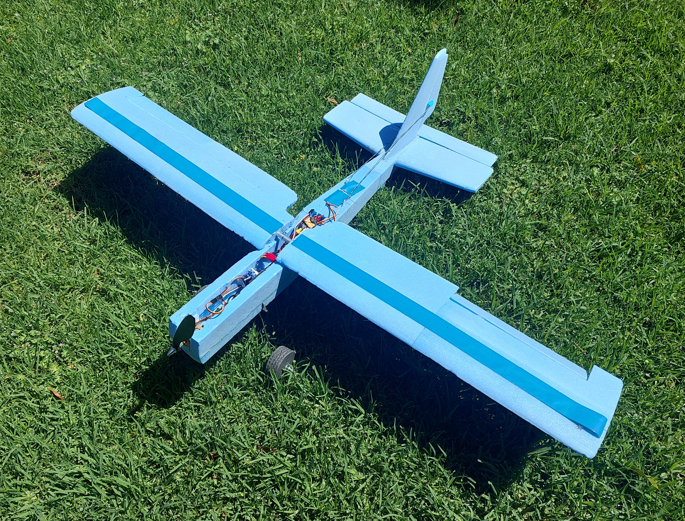
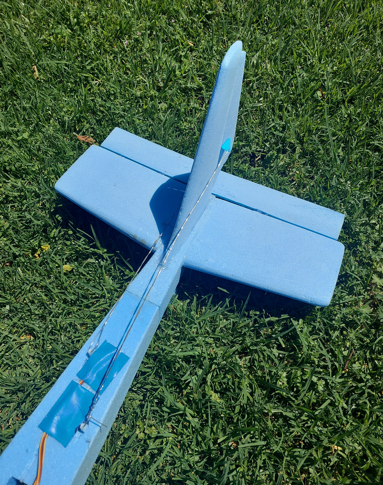
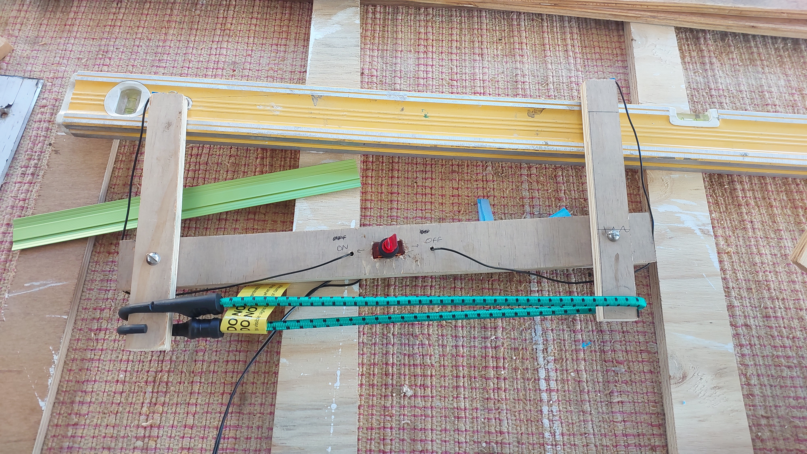
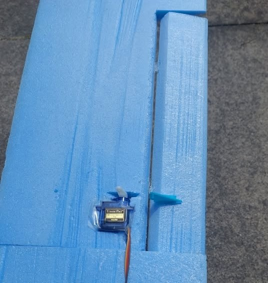
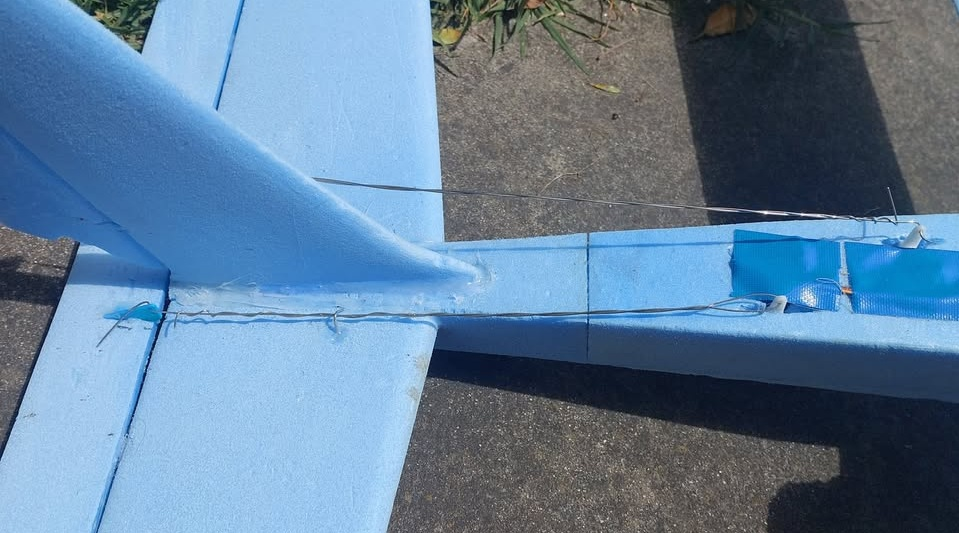
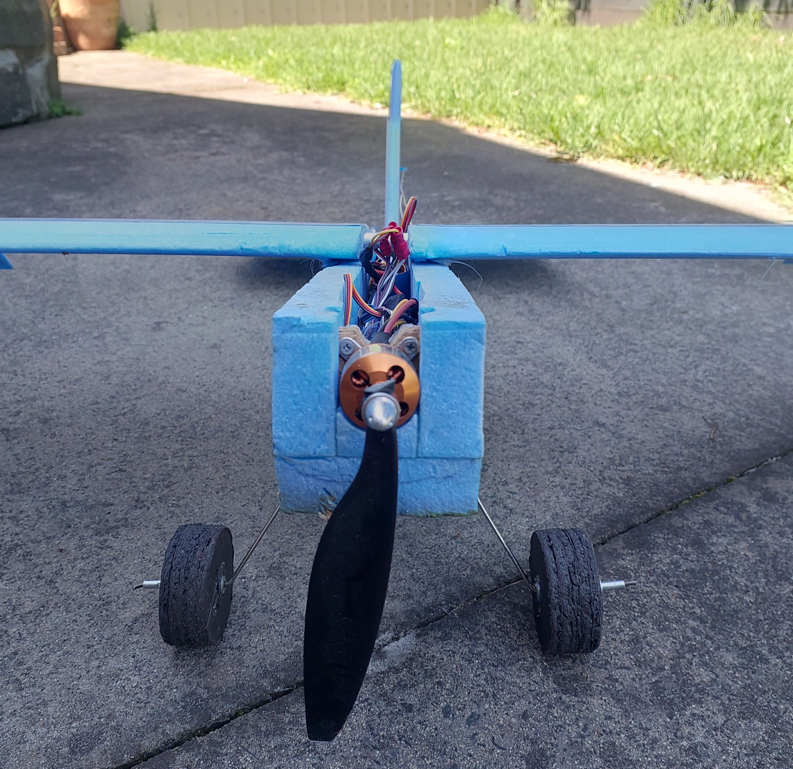
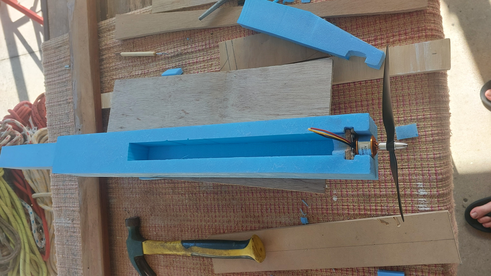

# Building an RC Foam Plane from Scratch

*A 1.2 m wingspan electric foam plane, designed and built for a first-time pilot.*

I designed and built a 1.2 m electric foam plane from scratch, aiming for a \$150 budget and a design a novice pilot could fly. It finished at about \$225 and taught me a lot about budgeting, testing and building for durability. It flew about ten short flights, took repeated hard landings and nose dives, and ended with a heavy crash on its 11th flight.

   
  <em>The plane after its flights and crashes.</em>

https://github.com/user-attachments/assets/e40760a3-c0c4-470f-ac7d-daadd55e808e

<em>Compilation of flights and crashes.</em>

**At a glance**

- **Type:** Electric RC plane, about 1.2 m wingspan, 760 g ready to fly
- **Timeline:** 6 months in my free time, roughly 70 hours of work (a rough estimate, I didn't keep a log)
- **Budget:** \$150 target, about \$225 actual
- **Result:** A durable plane that took off consistently and survived repeated hard landings
- **Skills:** CAD, hot wire cutting, sanding and sculpting, soldering, systems integration

---

## Why I built it

I have a passion for radio controlled (RC) anything. After owning an RC truck, I wanted a different kind of vehicle and landed on a fixed-wing plane. The brief was simple: build a working plane around my own airframe and bought electronics, keep the cost low, make it survive crashes, and fly it.

I made three early decisions that shaped everything else. The motor and battery were the hardest parts to change, so I designed the airframe around them.

- **Motor:** I weighed winding my own, buying a kit and buying parts individually. A kit that included the speed controller, propeller and mount saved time and avoided compatibility problems, so I bought it.
- **Battery:** My existing battery was too heavy for any design I was willing to build. I bought two high-capacity 3S RC plane batteries for \$45.
- **Material:** A wooden frame wrapped in film was an interesting option, but foam was stronger, cheaper and faster to prototype.

---

## Design and dimensions

My inspiration came from seaplanes in movies like *Porco Rosso*. I also drew on entry-level planes such as the Cessna 172 Skyhawk and RC "trainers", because I wanted the stability, simplicity and strength of basic shapes.

   
  <em>Early sketches used for initial ideas and planning. They were never formalised, and next time I plan to keep proper design notes.</em>

The motor and propeller set the wingspan. My research suggested a propeller 15 to 30% of the wingspan, so I mocked up sizes and settled on about 1.2 m for an 8-inch prop. I based the fuselage on the Cessna 172's ratio to wingspan (about 0.75) and sized the tail the same way. I decided the overall shape mattered more than exact dimensions on a prototype, so some parts changed to get the right curves. The tail shows this best.

   
  <em>Close-up of the tail section, including the control surfaces and servos.</em>

- **Wings:** two 60 cm halves with a small gap, 18 cm chord, about 3° dihedral
- **Fuselage:** 80 cm long, tapering from the midpoint
- **Tailplane:** 42 × 12 cm at the centre, tapering outwards
- **Rudder:** triangle, 14 cm base × 22 cm high
- **Elevator:** one piece, 40 × 5 cm
- **Ailerons:** 25 × 5 cm, starting 5 cm in from each wingtip
- **Weight:** 760 g including the 130 g battery. Wing area is about 21.6 dm², so wing loading was roughly 35 g/dm², very light.

---

## The wing

I wanted high lift, strength and stability. I came across the KFm wing family on [Flite Test](https://www.flitetest.com/articles/kfm-wings-a-basic-explanation) and started with the KFm-3, a high-lift profile. I liked its thin trailing edge, which could double as the control surfaces.

   
  <em>The KFm wing family, from the Flite Test website.</em>

**Problem: the profile didn't survive the build.** My 3D-printed PLA template melted and caught the hot wire, ruining both the foam and the template. A sanded wooden template worked, but the thin rear ledges broke off easily, and I worried the wing would be weak there. I switched to a conventional semi-symmetric profile.

**Building it.** I cut the 1200 × 600 × 50 mm XPS board into sections with the hot wire cutter, using levels as guides. My cutter could only cut as wide as its frame, so I cut each wing in sections and glued them with glue and toothpicks for support. The joins left slight deviations, which I sanded smooth. An aluminium spar runs through each wing, bent in the middle to give the dihedral.

How I made the hot wire cutter

Buying a cutter would have added to the cost, and none were available locally, so I built one from parts I already had plus nichrome wire (\$15, which I hadn't planned for). It runs from the DC output of my SkyRC LiPo charger. I set the voltage just high enough to heat the wire, to keep risk low.

   
  <em>The homemade hot wire cutter used to cut and shape the foam.</em>

The cutter was weak on tension, so I made cuts slowly to avoid stretching the wire and bending the cut, and it was hard to keep straight over long distances. A better-tensioned cutter is the first thing I'd improve.

---

## Control surfaces and servos

The plane has four 9 g micro servos: one per aileron, one for the rudder, and one for the single-piece elevator. I sized the surfaces from reference designs, cut them out of the wing, and reattached them with cut plastic tabs as hinges, then fitted mounts for the servo wires.

**Problem: the linkages bent.** The wires connecting the servos to the surfaces were strong in tension but too thin to resist compression. Winding a second layer of wire around the first made them stiffer and gave better control. They were still weak, though, and combined with surfaces that were too small, this was the biggest reason for the plane's poor agility.

   
  <em>Close-up of the wing servo mount and control surface, before the linkage was fitted.</em>

   
  <em>Close-up of the tail servo mounts and control surfaces, including the rewound wire for extra strength.</em>

---

## Motor mount and electronics

The motor kit's mount attaches to a wooden plate that slots into the front of the fuselage. Toothpicks slid between the wood and the foam act as friction holds, so the mount stays secure but can be removed.

   
  <em>The removable motor mount that held the motor in flight. The toothpicks that lock it in place aren't shown.</em>

- **Motor:** 1400 kV, 10-turn, with an 8045 propeller
- **ESC:** 40 A
- **Battery:** Ovonic 3S 2200 mAh 35C, 11.1 V
- **Radio:** FlySky FS-i6 with a FlySky receiver

Soldering and testing the electronics took about 5 hours. That included adding a switch between the battery connector and the ESC, and resoldering the motor and battery plugs. Transmitter setup was mostly plug and play. The receiver took more research because assigning channels and connecting everything was difficult, but it's a very common receiver, so I could follow online videos.

---

## Wing mount and final touches

**Problem: the wing joint broke on hard landings.** I first held the wing on with hot glue on the foam surface, which was weak. Heavy-duty duct tape gave a strong join that was also removable and adjustable.

The wing sits on the balance point, about 30% of the way along the fuselage. I shuffled the battery around to test different orientations, and mostly kept it central or slightly ahead of the wing. Tape covered the holes and cuts, with the wiring running through the body. The landing gear is custom foam and wire, and I often reshaped it after hard landings.

   
  <em>The front of the plane after its crashes, showing the landing gear and motor, with the propeller broken and the wings detached.</em>

---

## Budget

I built a rough budget from online prices, aiming for \$150, and spent about \$225.

- **Frame and body:** planned \$30, spent about \$40 (foam board and aluminium rods)
- **Motor, ESC and battery:** planned \$70, spent about \$105. The motor and ESC combo was cheap (\$60), but buying new batteries (\$45) pushed me over budget.
- **Radio and servos:** planned \$50, spent \$65. A good deal on the radio and receiver on Facebook Marketplace (\$50), plus extra servos (\$15).
- **Tools:** planned \$0, spent \$15 on nichrome wire for the hot wire cutter
- **Repairs:** \$0, using tape and glue I already owned

I finished about \$75 over. I saved money by building the hot wire cutter myself, buying a second-hand radio, and reusing materials for repairs. I was happy with the result, and the project improved my budgeting and research skills.

---

## Results

The plane flew about ten short flights in sunny to overcast conditions with light wind.

- **Flying:** It took off consistently from grass and flew in light breezes. It had plenty of power, and I never needed full throttle. It could turn, follow a circuit and recover from a dive, but I couldn't make it follow a path of my choosing.
- **Wind:** At about 35 g/dm², the very light airframe was pushed around and carried downwind, and it couldn't turn against the wind. Weak control surfaces made this worse.
- **Durability:** It handled repeated hard landings and nose dives with only light repairs. A friend flew the 11th flight and crashed it heavily, all in good fun.

For a first attempt by a novice pilot, it did what I wanted. It never flew for long or gained much altitude, and controlling it well was beyond my ability at the time. It also had no flight controller, which would have helped with stability.

[▶ Watch the full flights video on YouTube](https://www.youtube.com/watch?v=6i3lF9emXYw)

<em>A longer compilation of all the flights, extending the video at the top.</em>

---

## What I'd do differently

- Make it heavier, so it copes better with wind and has a lowerwing loading.
- Shrinking the sizing to reduce drag
- Layer with plastic wrap for reduced drag
- Add a flight controller for increased controllability and stability
- Build larger, stronger control surfaces to allow higher manuverability
- Build a smaller plane, and use a better-tensioned hot wire cutter
- prepare more replacement parts for flight testing.

**Biggest lessons:** Testing was king, experience is a great teacher, and it's worth building prototypes that last.

---

## Gallery

   
  <em>Pre-flight photo, with the wings not permanently attached.</em>

   
  <em>The body during construction, before the wing and tail sections were finished.</em>

https://github.com/user-attachments/assets/faee4666-af9f-442c-97ba-42f1e0b636d4

<em>Motor and servo testing.</em>

