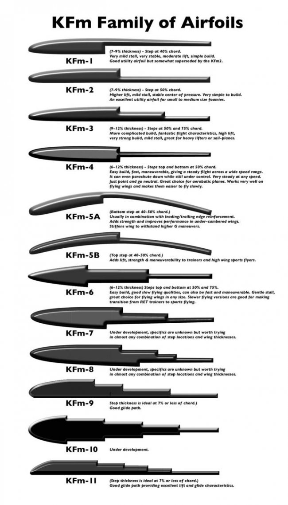
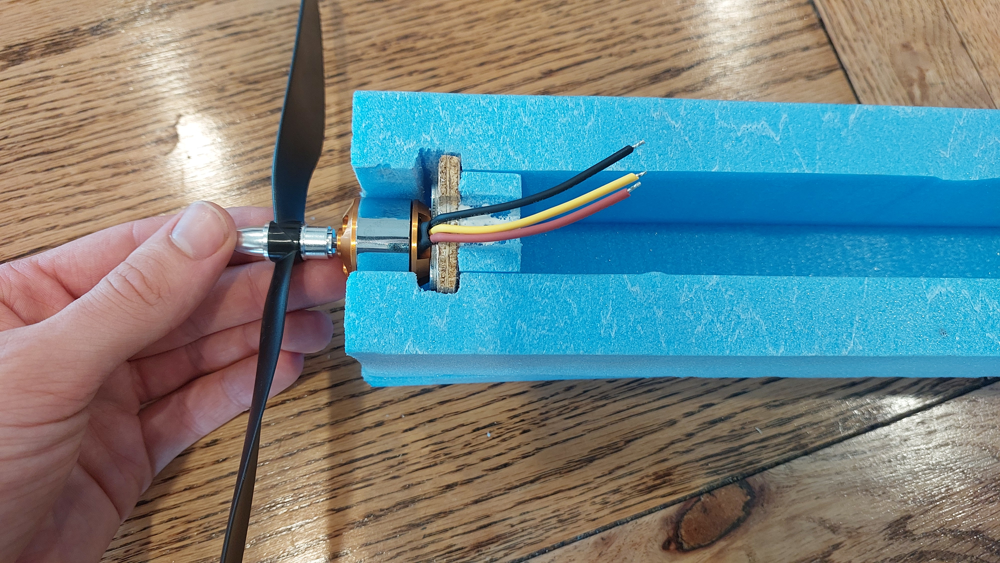

# Building an RC Foam Plane from Scratch

*A 1 m wingspan electric foam plane, designed and built for a first-time pilot.*

I designed and built a 1 m wingspan electric foam plane from scratch. My target was a budget of \$150 and a plane a novice, first-time pilot could fly. It finished at about \$225 and survived several large crashes along the way, and it taught me a lot about budgeting, testing and building for durability.

<!-- TODO: swap in your best photo, or link a flight video here -->

**At a glance**

- **Type:** Electric RC plane, 1.0 m wingspan
- **Timeline:** 6 months, built in my free time
- **Time spent:** about 67 hours before finishing and testing: 15 planning, 40 structure, 5 making tools, 5 electronics, 2 radio setup <!-- TODO: add finishing hours -->
- **Budget:** \$150 target, about \$225 actual
- **Headline result:** A sturdy design that survived several large crashes
- **Skills:** Sanding and sculpting, CAD, soldering, systems integration

---

## Why I built it

I have a passion for radio controlled (RC) anything. I had owned an RC truck, so I set out to build a different kind of vehicle and landed on a fixed-wing aircraft.

The constraints were simple. I had to build a working RC plane around my own airframe and bought electronics, while keeping the budget low.

My success criteria were:

- A successful maiden flight, followed by more flights for testing and improvements
- A plane that could withstand crashes
- A plane that was easy to fly

---

## Choosing the parts

Before building anything, I made three decisions that shaped the rest of the design. The motor and battery were the hardest parts to change later, so the airframe was designed around them.

**Motor.** I considered winding a custom electric motor, buying a motor kit, and buying the motor and other parts individually. At the prices I found online, a kit that included the speed controller, propeller and motor mount made the most sense, especially compared with the time a custom motor or finding compatible parts would take. I bought the kit.

**Battery.** I already owned a large RC battery, but it was not intended for any design I was willing to build. I found two 3S, high-capacity RC plane batteries for \$45 and bought those instead.

**Airframe material.** I compared a wooden frame wrapped in polyester film or paper with foam. The wooden option is interesting and flexible, but foam was stronger, cheaper and faster to prototype, which suited this project better. I went with foam.

---

## Overall design and dimensions

<!-- This section covers the big picture: concept, size and layout. Details of each part go in the sections below, so don't repeat them here. -->

### Concept

My initial inspiration came from seaplanes from movies like *Porco Rosso*. As the design progressed, I also drew on popular entry-level planes such as the Cessna 172 Skyhawk and other RC "trainer" airplanes, as I wanted stability, simplicity and strength that came with the more basic shapes and design.

### Sketches and layout

I started with sketches and reference designs. The sketches below show an example shape I wanted and a possible wing cross-section I was researching, along with some of my thinking.

### Dimensions

[Explain how you chose the size. For example: why 1.0 m wingspan, how the 1200 × 600 × 50 mm XPS board limited the wing and fuselage, and how the motor and battery weight influenced the layout.]

- **Wingspan:** 1.0 m
- **Length:** [length] m
- **Height:** [height] cm
- **Wing chord:** [chord]
- **Weight (ready to fly):** about 1.7 kg <!-- TODO: your results section says ~2 kg, pick one -->
- **Wing loading / CG:** [add if you have it]

The dimensions of the design were determined by several factors. The most important was the motor and propeller size, which was used as a basis for the wingspan. My research dictated that propeller length was 15 to 30% the length of the wingspan, so with that starting point, I mocked up sizes and determined the most fitting to be 1 meter. From there, I found fuselage to sit at 0.75:1 compared to wingspan, based on Cessna 172 dimensions. Tail and rudder followed similar processes.

---

## Wing profile and shape

<!-- Pattern for each component section: what it needed to do, how I designed it, how I built it, what went wrong or what I'd change. -->

**What it needed to do:** [e.g. give enough lift at low speed for a novice pilot, stay strong through crashes]
To design the wings, I also needed to determine the profile and shape I wanted. I required high lift and strength, as well as stability in flight. 

**Design:** [Explain your wing profile choice and why. Mention the aluminium spar running through the centre and why you bent it in the middle.]
During my research, I came across some novel model sized wing profiles, found [here](https://www.flitetest.com/articles/kfm-wings-a-basic-explanation), that had very interesting properties. Among them, I chose to start with the Kfm-3, a high lift, strong but complicated wing profile.

Although more complex than a standard wing profile, I indented to take advantage of the thin trailing edge as the control surfaces, and was drawn to the novel and interesting design.

### Making the hot wire cutter

I needed a way to cut and shape the foam, so I made a hot wire foam cutter. I researched the materials, then designed and built it using parts I already had and nichrome wire I bought (\$15, which I hadn't planned for).

[Add a photo of the cutter and a line on how it works.]

### Cutting and shaping the wing

I started with a rectangular 1200 × 600 × 50 mm XPS foam board and worked toward the shapes I wanted by cutting, shaping and gluing the foam until I was happy with it, redoing parts as needed. I designed the wing cross-section using a 3D-printed outline. [Explain how you used the outline with the hot wire cutter, then how you sanded the foam to its final shape.]

**What I'd change:** [anything you'd do differently with the wing]

---

## Motor mounting

**What it needed to do:** [e.g. hold the motor securely, point the thrust in the right direction, survive hard landings]

**Design:** The motor kit included a mount. [Explain where it sits on the fuselage and why.]

**Build:** [How you fixed the mount to the foam. Glue, screws, reinforcement? Include any thrust angle.]

**Specs:** 40 A ESC, [motor model, kV, size], [propeller size]

**What went wrong or what I'd change:** [add here, or delete]

---

## Control surfaces and servos

**What it needed to do:** [e.g. give a novice pilot enough control without being twitchy]

**Design:** [Explain how you sized the ailerons, elevator and rudder. Note how many surfaces the plane has and where each of the four 9 g micro servos sits.]

**Build:** [How you cut and hinged the surfaces and mounted the servos.]

**Linkages and the problem with them.** The wires connecting the servos to the control surfaces were strong in tension but too thin to resist compression, so they bent. Winding a second layer of wire around the first made them stronger, and the control surfaces were more controllable afterwards. They were still weak, though, and together with surfaces that were too small, this was a big reason for the plane's low agility (see Testing and results).

**What I'd change:** stronger, larger control surfaces. [Add anything more specific.]

---

## Main wing mount

**What it needed to do:** hold the wing firmly in flight but let it come off in a crash and let me adjust it. [Edit to match your reasoning.]

**First attempt:** I held the wing to the body with hot glue on the surface of the foam. The join was weak and broke on hard landings.

**The fix:** I switched to heavy-duty duct tape instead of gluing directly. This gave me a strong join that was also removable and adjustable.

---

## Electronics and radio

Soldering and connecting all the electrical components took about 5 hours, followed by testing the connections and servo power. [Add a photo of the wiring layout and where each component sits in the fuselage.]

The radio side took about 2 hours. Setting up the transmitter was mostly plug and play. Setting up the receiver took more research, because assigning channels and connecting everything was difficult. [Add what you found out, so the next builder doesn't have to.]

- **Radio:** FlySky FS-i6 transmitter with a FlySky receiver
- **Battery:** Ovonic 3S 2200 mAh 35C 11.1 V LiPo
- **Servos:** 4 × 9 g micro servos
- **ESC:** 40 A

---

## Final touches

[Describe the finishing stage: landing gear, covering, tape or paint, decals, and final checks such as the balance point (CG) and control direction checks.]

**Landing gear.** [Explain the design and what it was made from.] It took a lot of abuse, and I often had to reshape it after hard landings.

---

## Budget

After settling the main design choices, I created a rough budget from what I found online. I planned for \$150 and spent about \$225.

- **Frame and body:** planned \$30, spent about \$40. Foam board (\$29.85) and aluminium rods (\$10).
- **Motor, ESC and battery:** planned \$70, spent about \$105. The motor and ESC combo cost \$60 and was cheap, but deciding to buy new batteries (\$44.97) pushed me over budget.
- **Radio gear and servos:** planned \$50, spent \$65. I found a great deal on the radio and receiver on Facebook Marketplace (\$50), but I needed to buy extra servos (\$15) because I didn't have enough on hand.
- **Tools and consumables:** planned \$0, spent \$15. I had no heat-resistant wire, so I bought nichrome wire for the hot wire cutter.
- **Spares and repairs:** planned \$0, spent \$0. I made repairs with strong tape and glue I already owned.

<!-- TODO: your line items add up to $224.82, but your earlier draft total said $224.92. Check which is right. -->

I went about \$75 over budget. I was happy with the result, though, since I bought everything at good prices and came away with stronger budgeting and research skills.

**Where I saved money:** a 3D-printed wing template, a homemade hot wire cutter, and a second-hand radio from Facebook Marketplace.

---

## Testing and results

**Test conditions:** sunny to overcast, low wind with light gusts.

<!-- Keep the effects here and the causes in the build sections above. A short cross-reference is enough. -->

**Stability.** The plane got into controlled flight without crashing. As a first-time flyer with nothing to compare it to, it is hard to judge how it stacks up against a strong plane.

**Power.** It had enough power to take off from a grassy field and fly in light breezes. Its power-to-weight ratio was high, and it could support its own weight on thrust alone. I never needed full power during testing.

**Agility.** It could turn, follow a circuit and recover from a dive, but I couldn't make it follow a path of my choosing. In any amount of wind, the light airframe was pushed around and carried downwind. It couldn't turn against the wind or fly consistently straight, mainly because the control surfaces were too small and too weak (see Control surfaces and servos).

**Weight.** The plane weighed about 2 kg. <!-- TODO: reconcile with 1.7 kg above --> Its power and lift for that weight were very high, and it was large, so it was too light to cope with wind.

**Reliability.** It survived many hard landings and crashes. Being so light, the foam structure handled most impacts, even several nose dives into the ground. It needed some light repairs, and I often had to reshape the landing gear, but it survived.

**Overall.** For a first attempt by a novice pilot, the plane did well. It never took a long flight or gained much altitude, but it took off consistently and flew short distances. The results say as much about me as a pilot as about the plane, since controlling it well was beyond my ability at the time. The design also had no flight controller, which would have helped with stability and control.

[Add your test video here, plus any data logs or screenshots.]

---

## What I'd do differently

I'd change four things in a second build: make the plane heavier so it copes better with wind, add a flight controller, build stronger control surfaces, and go for a smaller plane overall.

**What went well:** the power, and the durability.

**Biggest lessons:** testing is king, experience is a great teacher, and it's worth building prototypes that last.

---

## What this project showed

- **Technical:** CAD and 3D printing for the wing template, hot wire cutting, sanding and shaping, metalworking, soldering and systems integration
- **Engineering thinking:** weighing trade-offs between options, testing, and troubleshooting failures
- **Project management:** researching, budgeting and sourcing parts
- **Personal:** learning on my own and sticking with a project through repeated crashes and repairs

---

## Gallery

[Add video links here: maiden flight, build highlights, crashes.]
