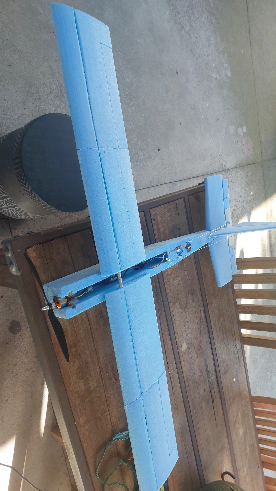
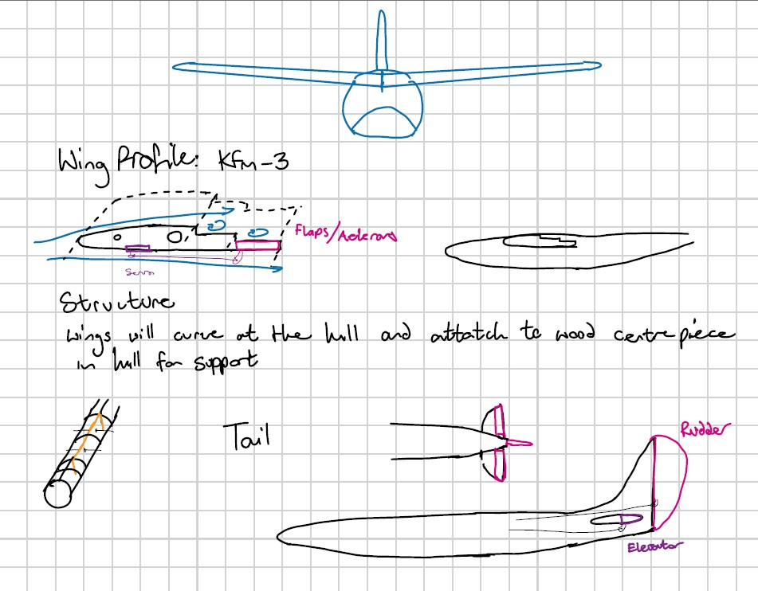

# Building an RC Foam Plane from Scratch

*A 1 m wingspan electric foam plane, designed and built for a first-time pilot.*

I designed and built a 1 m wingspan electric foam plane from scratch. My target was a budget of \$150 and a plane a novice, first-time pilot could fly. It finished at about \$225 and survived several large crashes along the way, and it taught me a lot about budgeting, testing and building for durability.

<!-- TODO: swap in your best photo, or link a flight video here -->

**At a glance**

- **Type:** Electric RC plane, 1.0 m wingspan
- **Timeline:** 6 months, built in my free time
- **Budget:** \$150 target, about \$225 actual
- **Headline result:** A sturdy design that survived several large crashes
- **Skills:** Sanding and sculpting, CAD, soldering, systems integration

---

## Why I built it

I have a passion for radio controlled (RC) anything. I had owned an RC truck, so I set out to build a different kind of vehicle and landed on a fixed-wing aircraft.

The constraints were simple. I had to build a working RC plane around my own airframe and bought electronics, while keeping the budget low.

My success criteria were:

- A successful maiden flight, followed by more flights for testing and improvements
- A plane that could withstand crashes
- A plane that was easy to fly

---

## Design

### Concept

My initial inspiration came from 1930s seaplanes, specifically the Macchi M.33 racing plane associated with the main character in the movie *Porco Rosso*. <!-- TODO: double-check the M.33 date and its Porco Rosso connection --> As the design progressed, I also drew on popular entry-level planes such as the Cessna 172 Skyhawk and RC "trainer" airplanes.

### Process

I started with sketches and reference designs. The sketches below show the shape I wanted and a possible wing cross-section, along with some of my thinking.

### Key decisions

**Motor.** I considered winding a custom electric motor, buying a motor kit, and buying the motor and other parts individually. At the prices I found online, a kit that included the speed controller, propeller and motor mount made the most sense, especially compared with the time a custom motor would take. I bought the kit.

**Battery.** I already owned an RC battery, but it was too heavy for any design I was willing to build. I found dual 3S, high-capacity RC plane batteries for \$45 and bought those instead. <!-- TODO: "dual" = two packs? Your specs list one Ovonic 3S 2200 mAh -->

**Airframe material.** I compared a wooden frame wrapped in polyester film or paper with foam. The wooden option is interesting and flexible, but foam was stronger, cheaper and faster to prototype, which suited this project better. I went with foam.

---

## Specifications

- **Wingspan:** 1.0 m
- **Overall size:** [length] m long, [height] cm high
- **Weight (ready to fly):** about 1.7 kg <!-- TODO: your results section says ~2 kg, pick one -->
- **Motor:** [model, kV, size]
- **ESC:** 40 A
- **Battery:** Ovonic 3S 2200 mAh 35C 11.1 V LiPo
- **Radio:** FlySky FS-i6 transmitter with a FlySky receiver
- **Servos:** 4 × 9 g micro servos
- **Wing loading / CG:** [add if you have it]

---

## The build

I started with a rectangular 1200 × 600 × 50 mm XPS foam board and worked toward the shapes I wanted by cutting, shaping and gluing the foam until I was happy with it, redoing parts as needed. I designed the wing cross-section using a 3D-printed outline. <!-- TODO: finish this thought, e.g. how you used the outline with the hot wire cutter -->

### Planning and sourcing (about 15 hours)

This phase was mostly research and brainstorming over a few days, using Google, RC forums and guides. I spent most of the time on materials, manufacturing choices and the overall design.

### Structure (about 40 hours)

I chose foam board as the main structural material and designed the wing around an aluminium spar running through its centre, bent in the middle. I shaped the foam mainly by hot wire cutting and sanding, and iterated on the wing cross-section until it worked.

### Tools (about 5 hours)

I needed a way to cut and shape the foam, so I decided to make a hot wire foam cutter. I researched the materials, then designed and built it using parts I already had and wire I bought.

### Electronics and wiring (about 5 hours)

I soldered and connected all the electrical components, then tested the connections and servo power.

### Radio setup (about 2 hours)

Setting up the transmitter was mostly plug and play. Setting up the receiver took more research, because assigning channels and connecting everything was difficult.

### Finishing and testing

[Describe finishing: covering, paint or tape, final checks, and any first test steps.]

---

## Budget

After settling the main design choices, I created a rough budget from what I found online. I planned for \$150 and spent about \$225.

- **Frame and body:** planned \$30, spent about \$40. Foam board (\$29.85) and aluminium rods (\$10).
- **Motor, ESC and battery:** planned \$70, spent about \$105. The motor and ESC combo cost \$60 and was cheap, but deciding to buy new batteries (\$44.97) pushed me over budget.
- **Radio gear and servos:** planned \$50, spent \$65. I found a great deal on the radio and receiver on Facebook Marketplace (\$50), but I needed to buy extra servos (\$15) because I didn't have enough on hand.
- **Tools and consumables:** planned \$0, spent \$15. I had no heat-resistant wire, so I bought nichrome wire for the hot wire cutter.
- **Spares and repairs:** planned \$0, spent \$0. I made repairs with strong tape and glue I already owned.

<!-- TODO: your line items add up to $224.82, but your draft total says $224.92. Check which is right. -->

I went about \$75 over budget. I was happy with the result, though, since I bought everything at good prices and came away with stronger budgeting and research skills.

**Where I saved money:** a 3D-printed wing template, a homemade hot wire cutter, and a second-hand radio from Facebook Marketplace.

---

## Testing and results

**Test conditions:** sunny to overcast, low wind with light gusts.

**Stability.** The plane got into controlled flight without crashing. As a first-time flyer with nothing to compare it to, it is hard to judge how it stacks up against a strong plane.

**Power.** It had enough power to take off from a grassy field and fly in light breezes. Its power-to-weight ratio was high, and it could support its own weight on thrust alone. I never needed full power during testing.

**Agility.** It could turn, follow a circuit and recover from a dive, but I couldn't make it follow a path of my choosing. In any amount of wind, the light airframe was pushed around and carried downwind. It stayed in the air, but it couldn't turn against the wind or fly consistently straight, because the control surfaces were too small and too weak.

**Weight.** The plane weighed about 2 kg. <!-- TODO: reconcile with 1.7 kg in the specs --> Its power and lift for that weight were very high, and it was large, so it was too light to cope with wind.

**Reliability.** It survived many hard landings and crashes. Being so light, the foam structure handled most impacts, even several nose dives into the ground. It needed some light repairs, and I often had to reshape the landing gear, but it survived.

**Overall.** For a first attempt by a novice pilot, the plane did well. It never took a long flight or gained much altitude, but it took off consistently and flew short distances. The results say as much about me as a pilot as about the plane, since controlling it well was beyond my ability at the time. The design also had no flight controller, which would have helped with stability and control.

[Add your test video here, plus any data logs or screenshots.]

---

## Problems and how I solved them

**The wing joint broke on hard landings.**
The wing was held to the body with hot glue on the surface of the foam, which made the join weak. I switched to heavy-duty duct tape instead of gluing directly. This gave me a strong join that was also removable and adjustable.

**The control surface wires were weak and bent.**
The wires connecting the servos to the control surfaces were strong in tension but too thin to resist compression. Winding a second layer of wire around the first made them stronger, and the control surfaces were more controllable afterwards. They were still weak, though, which was a big reason for the plane's low agility.

---

## What I'd do differently

I'd change four things in a second build: make the plane heavier so it copes better with wind, add a flight controller, build stronger control surfaces, and go for a smaller plane overall.

**What went well:** the power, and the durability.

**Biggest lessons:** testing is king, experience is a great teacher, and it's worth building prototypes that last.

---

## What this project showed

- **Technical:** CAD and 3D printing for the wing template, hot wire cutting, sanding and shaping, metalworking, soldering and systems integration
- **Engineering thinking:** weighing trade-offs between options, testing, and troubleshooting failures
- **Project management:** researching, budgeting and sourcing parts
- **Personal:** learning on my own and sticking with a project through repeated crashes and repairs

---

## Gallery

[Add video links here: maiden flight, build highlights, crashes.]

