# 3D Printed RC Trophy Truck

*A 1:10 scale, trophy-truck-inspired RC car with a 3D printed body.*

This write-up covers the design and build of my 1:10 scale RC truck, which has a 3D printed body and premade electronic components. My goals were to make a functional, durable and stylised truck, to find out which parts could be 3D printed, and to practise iterative design and CAD in preparation for future 3D printed projects. There was no fixed budget, since I ordered parts as I needed them and spent money on unplanned R&D. The parts I bought came to about \$228, not counting filament or parts I already owned. The project taught me some important lessons about design, building and RC control systems.

   
  <em>The finished truck.</em>

**At a glance**

- **Type:** 1:10 fully custom electric trophy truck
- **Timeline:** 6 months, roughly 100 hours of work
- **Budget:** No fixed budget. About \$228 in bought parts, plus about 3 kg of filament
- **Result:** Handled gravel, grass and jumps, but limited by belt slip and weak suspension
- **Skills:** CAD, 3D printing, soldering, system integration, iterative design

---

## Why I built it

After designing and building my [foam RC plane](RC_Plane.md), I got access to a 3D printer. I was eager to start a project with it, and a custom RC car was a natural choice, since cars are the type of RC vehicle I have the most experience with. This time I wanted a truck that could handle jumps, and I took inspiration from trophy truck suspension: a 4-link rear and double wishbone front.

Early decisions that shaped the design:

- **Suspension:** The project was built around long-travel trophy truck suspension, so the drivetrain, power system, steering, body and scale were all decided from there.
- **Scale:** I chose 1:10 as the middle ground. It's large enough for strong 3D printed parts and for suspension to matter, and small enough that the motor and other bought parts wouldn't be too expensive. I also owned a 1:10 short course truck to use as a reference.
- **Motor:** I considered nitro (liquid fuel), brushed electric and brushless electric. I chose brushless electric for enough power, durability and simplicity.
- **Drivetrain:** I compared metal gears, 3D printed gears and a belt system. I chose a belt because I believed it was more forgiving for 3D printed parts, needing less precision and strength than a gear system (this assumption turned out to be wrong, as Stage 2 explains). I bought the rear differential, since I judged a printed one would be too weak.

---

## Design and dimensions

The design was inspired by Baja trophy trucks, where a solid 4-link rear axle and independent front suspension give great stability and travel. My custom design had to house a drive motor, steering servo, gearing and driveshaft, rear axle, front and rear wheels, and the suspension.

  <a href="RC_Car_V1/Example_Truck.jpg">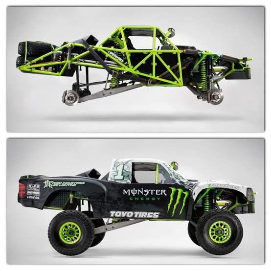</a> 
  <em>Design inspiration: a Baja trophy truck.</em>

I calculated the scaled body length and width from standard trophy truck dimensions, along with a rough body and shell shape. That gave a truck 32 cm long and 25 cm wide, a 1.28:1 length-to-width ratio. I designed from the front to the back. The front was the most complex section and needed the most precision, so the body and rear followed from it.

  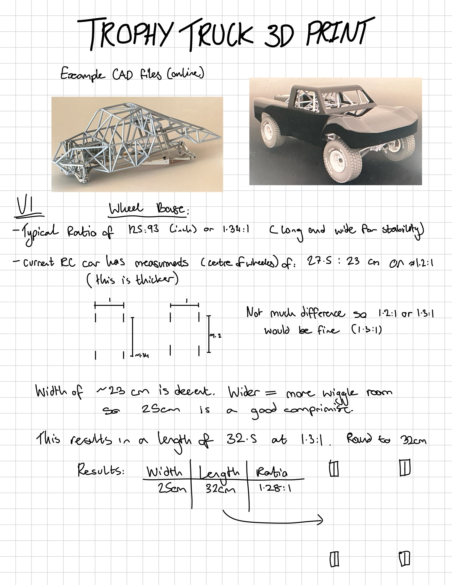
  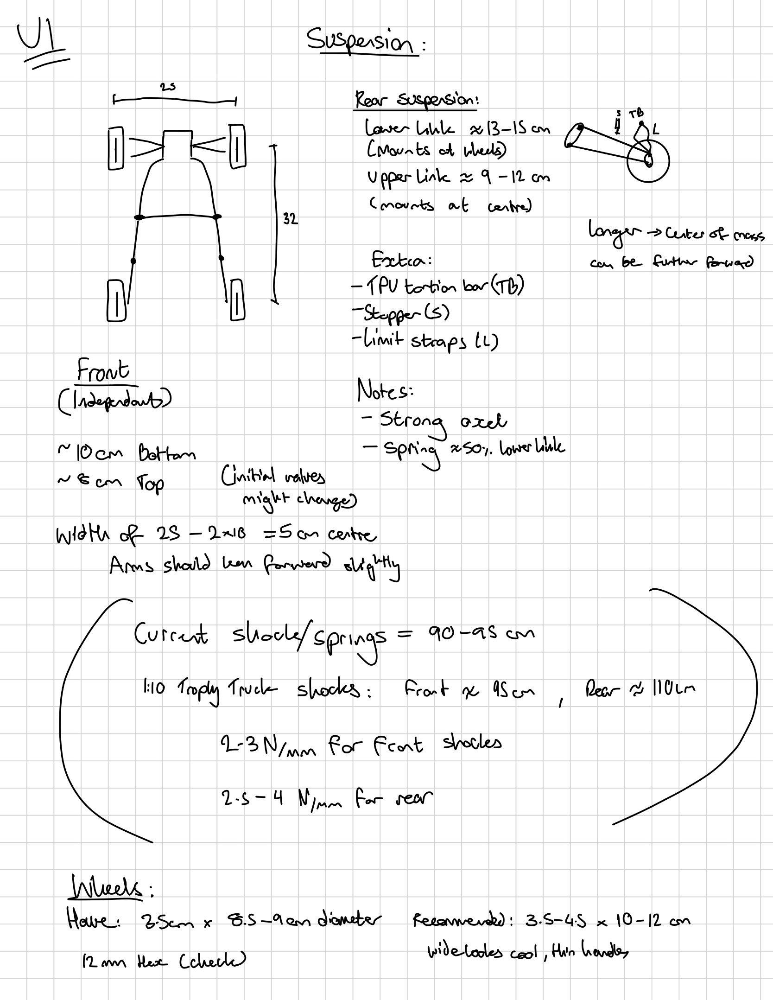
  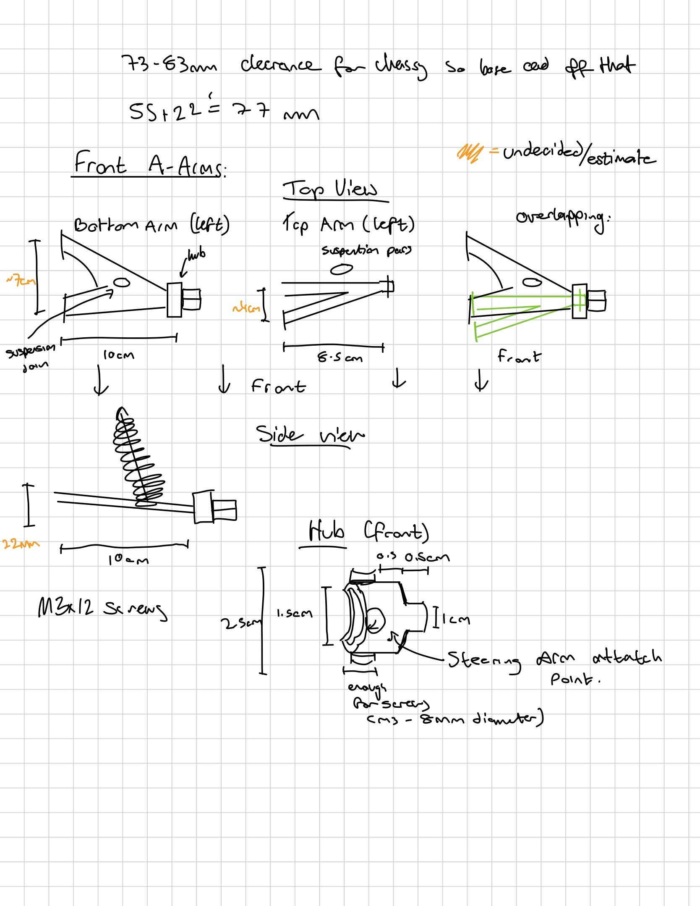 
  <em>Sketches exploring the shape of the truck.</em>

- **Scale / type:** 1:10
- **Size:** 32 cm long × 25 cm wide, a 1.28:1 length-to-width ratio
- **Power distribution:** Rear-wheel drive. It started as 4WD, but 2WD was simpler and more durable.
- **Drivetrain:** Belt drive (12-tooth to 32-tooth pulleys) into a purchased solid rear differential with a 30:8 ratio, about 10:1 overall
- **Suspension:** Independent double wishbone at the front, long-travel solid axle with 4-link at the rear
- **Tyres:** 110 mm off-road tyres
- **Weight:** about 2.06 kg including battery, with the rear axle alone around 400 to 600 g

---

## Stage 1: The front

The front needed to house the two independent spring and shock units, the shock tower, wheel hubs and joints, and the steering arms and links. That meant it had a lot of moving parts, all of which had to reach their extremes without interfering with each other. It also had to be strong, since it takes the brunt of impacts and collisions.

  <a href="RC_Car_V1/front.jpg">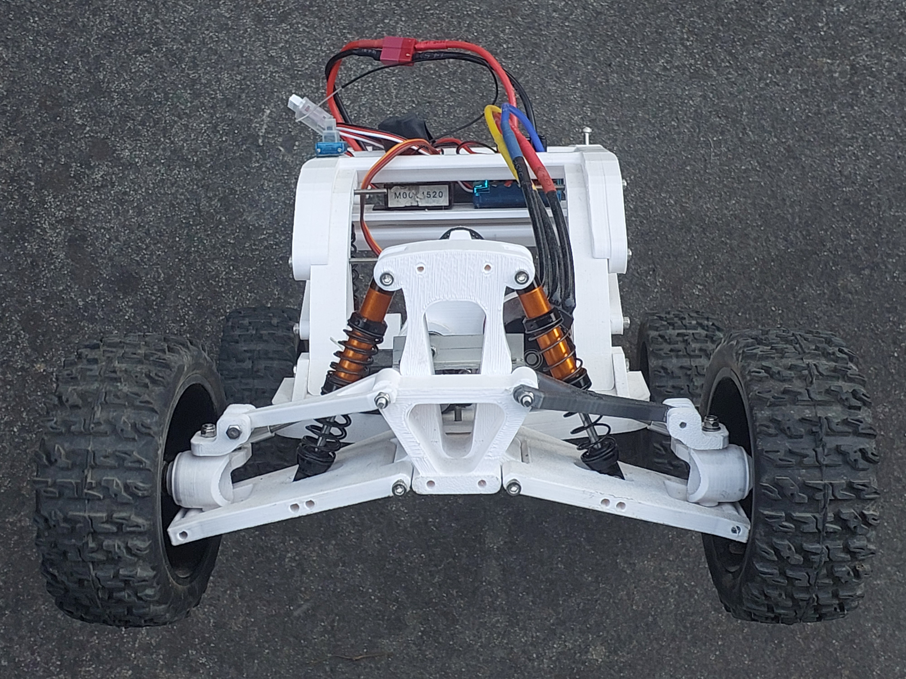</a> 
  <em>The front section of the truck, face on.</em>

**Problem 1: too many moving parts to integrate at this scale.** Fitting so many moving parts together correctly was difficult at such a small size. To simplify, I changed the drivetrain from 4WD to rear-wheel drive. This greatly simplified the wheel hubs, and it solved a gearing problem I found while planning the drivetrain: the front differential I bought didn't match the gear ratio of the rear differential.

**Problem 2: loose steering.** The steering was very loose, and it would hit the sides of the body and get caught. I strengthened the servo mount and replaced the servo arm with a stiffer one, but the problem isn't completely resolved.

  <a href="RC_Car_V1/all2.jpg">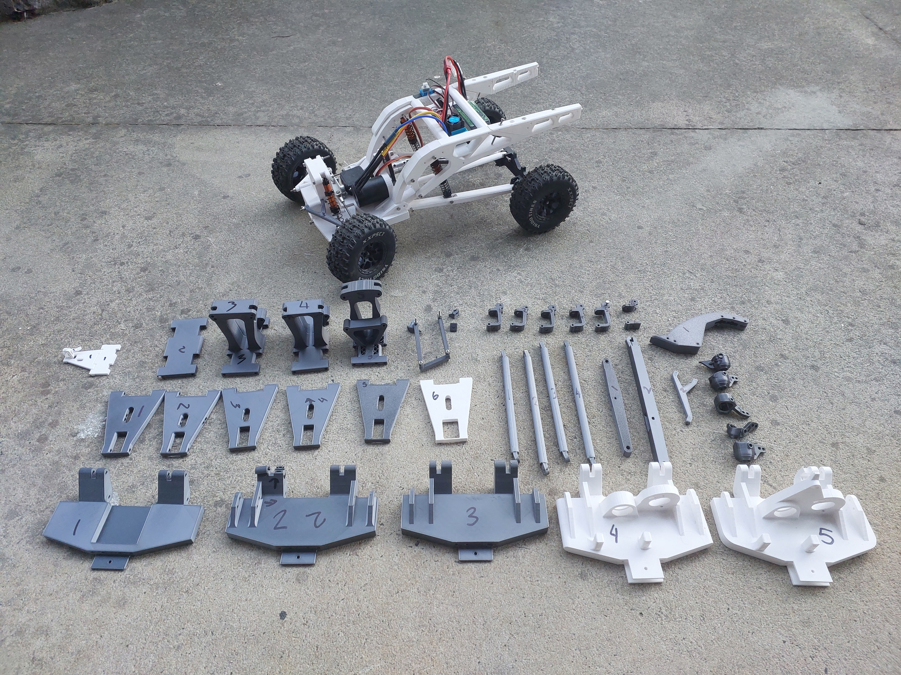</a> 
  <em>Several iterations of mostly front-end parts laid out together, from first prototypes (grey PLA, cheaper but less durable) to final versions (white PETG, more durable but more expensive).</em>

The front took the longest to complete. It needed the most iterations and the most careful design for strength and function. It's also where parts broke the most in testing, and where the most improvements are still to be made.

---

## Stage 2: Body and rear

The body had to hold the drive motor, steering servo and gearing, and connect the front and rear sections. To size and arrange the motor mounts and orient them to deliver power in the right place, I made placeholder CAD models of the parts. I also designed attachment points for body panels, but never made the panels, because the base system still had too many unresolved problems.

### The belt drive: my biggest wrong assumption

I chose a belt drive because I believed it would give me more freedom in placing parts than gears. In reality it caused more problems than gears would have:

- It needed high tension, which meant stronger parts, removing the benefit I'd chosen it for.
- The belt was long enough to need a tensioner, which reduced efficiency.
- It slipped under the motor's high torque, because I couldn't keep the tension high.
- It moved and rubbed against the plastic, losing more efficiency and power.
- The driveshaft hit the rear upper links.

I never fully resolved the belt problems, so redesigning the drive is a priority for V2.

  <a href="RC_Car_V1/close1.jpg">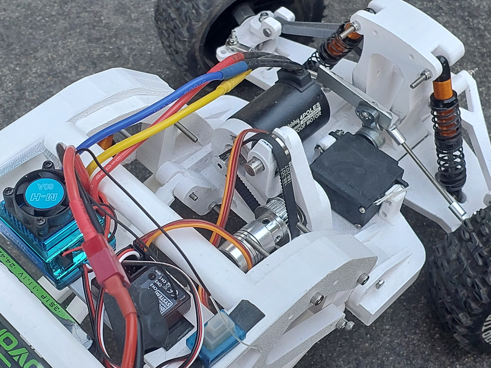</a> 
  <em>Close-up of the main body, showing the belt drive and motor mounting.</em>

### The rear

The rear was simple by comparison. The body, battery and ESC mounts were easy, since I had built placeholder models in CAD. The rear link arms were harder, because my placeholder differential wasn't an exact match, but I completed them.

**Problem 1: stiff link joints.** The printed link joints fit snugly for strength, but that limited the range of motion, especially in twisting.

**Problem 2: rubbing links.** The thinner upper links rubbed slightly against the driveshaft at full extension. It was low on my priority list, so I left it.

**Problem 3 (the main one): too much unsprung weight.** When I bought the rear axle and differential, I didn't consider their weight. The axle alone weighed roughly 400 to 600 g, around 20 to 30% of the truck's 2.06 kg total, before counting the wheels and tyres. That left a lot of weight on the wheel side of the suspension and very little on the body side, so the suspension was largely redundant. It did keep the battery and ESC sprung and away from the harshest bumps, but ride quality was poor overall. This is a big reason I want to 3D print or build the axle from base materials next time.

  <a href="RC_Car_V1/rear_close.jpg">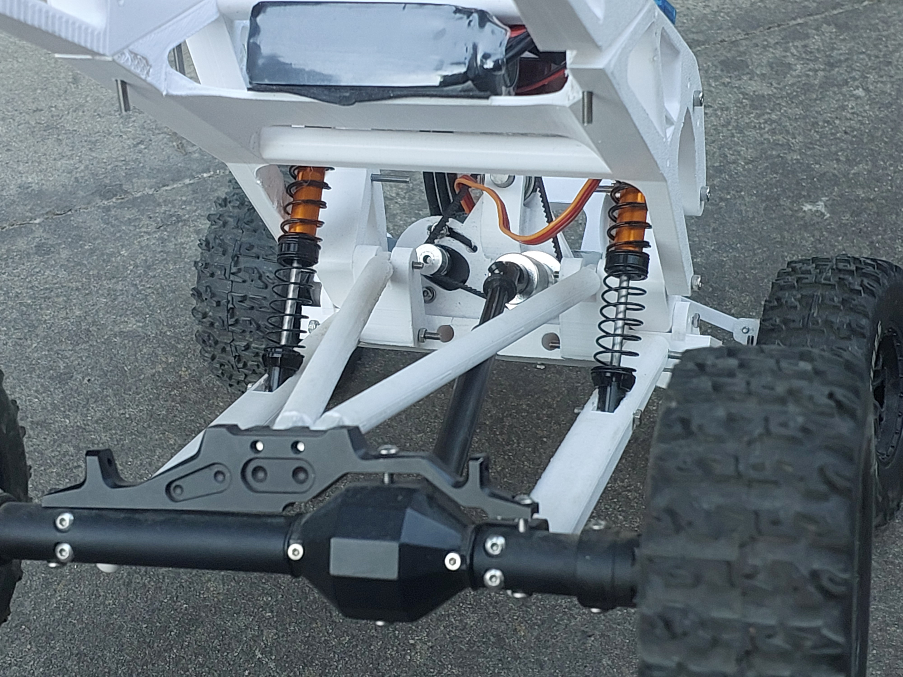</a> 
  <em>[Caption: the rear axle, differential and 4-link suspension.]</em>

---

## Motor, electronics and radio

The electronics were the simplest part of the project. Mounting was easy because I'd designed the mounting locations in advance, and soldering the motor and ESC cables didn't take long.

- **Motor:** 3650, 3100 kV, 4-pole brushless
- **ESC:** advertised as 80 A (likely lower in reality)
- **Battery:** 3S LiPo, 2200 mAh, 35C
- **Radio:** MVK transmitter and receiver, reused from my other RC car
- **Servo:** High-torque metal gear

---

## Testing and repairs

During testing I replaced several broken parts, including upper link arms and front-to-body mounts. I never finished the body panels or any cosmetic finishing, since the base system had too many unresolved problems.

---

## Cost

There was no fixed budget. I ordered parts as I needed them and already owned everything else, so the parts I bought came to about \$228. Filament isn't included: I used about 3 kg in total (1.5 spools of 2 kg), including prototypes and reprints.

- **Rear axle (aluminium):** \$58
- **Motor and ESC combo:** \$55.50
- **Suspension:** \$30
- **Wheels:** \$28
- **Driveshaft parts** (shaft \$11, rods \$5, link \$3): \$19
- **Front differential:** \$11
- **Bearings:** \$7
- **Rod ends:** \$6.50
- **Belt and gears:** \$5
- **Servo arm:** \$4.50
- **Thread inserts:** \$3

The rear axle was both my biggest single purchase and the heaviest part, so it cost me twice: once in money, and again in the unsprung weight problem. The front differential (\$11) was bought for the 4WD layout and went unused once I moved to rear-wheel drive.

---

## Results

I drove the truck on pavement with large steps, on gravel and on grass.

- **Performance:** It handled gravel and jumps well, but under high power the belt slipped and loosened over time.
- **Handling:** Moderate. The wheels often caught on the body, and the turning rate was limited by the steering link flexing, because it wasn't properly secured.
- **Durability:** It survived several crashes into walls unscathed and needed only a few replacement parts. Hard landings were a weak point, since the suspension was too weak for its weight.

Overall, this version didn't meet my expectations, but I'm happy with it because it taught me a lot about design and iterative work. Its shortfalls came from a mix of part selection and design assumptions. The suspension was too weak for the weight, so the truck often hit the ground. The belt drive slipped under high power, which a gear system wouldn't have. Two problems remain unresolved, the belt slip and the loose steering, and both are on the redesign list for a second version. That version will use more 3D printed components and apply what I've learned.

[Add your driving video here: drag `driving_video.mp4` into the GitHub editor, leave a blank line after the link, and put the caption in a separate paragraph.]

---

## What I'd do differently

- Design or buy stronger joints that allow more movement and more degrees of freedom
- Spend more time integrating the delicate moving parts, such as the steering and driveshaft, so they have enough clearance and aren't restricted
- Design connection points that are easier to access, quicker to use and stronger
- Design more simply, with more flexibility for changes later
- Check the weight of bought parts, such as the rear differential, before designing around them, and match the suspension to the truck's weight
- Use a gear drive instead of a belt
- Try 3D printing the axles and drivetrain, or build them from base materials (such as metal rods) combined with 3D printing, cutting and shaping, instead of buying complete components

**Biggest lesson:** for iterative design, parts need to be smaller and easier to print, connect, remove and replace, to cut down on wasted time, filament and broken components. One of my largest problems was that I had designed myself into a corner. I made large components that only worked in specific ways, then designed other components to depend on them. That limited my flexibility, and I spent a lot of effort on quick fixes to fundamental problems. Examples:

- Redesigning the rear linkages to improve joint flexibility and strength, instead of switching to a separate joint mechanism or moving the joint points
- Redesigning the main body section around the motor mount, bearing and driveshaft mount, when a tensioned belt system suits small, flexible, relatively weak printed parts poorly
- Reprinting and reattaching the front body section after it broke from stress concentrated at poorly designed joints
- Editing and reprinting body and steering parts because the front wheels rubbed against the body in sharp turns, when redesigning the steering or adjusting the front body to suit the wheels would have fixed it

---

## Gallery

  
  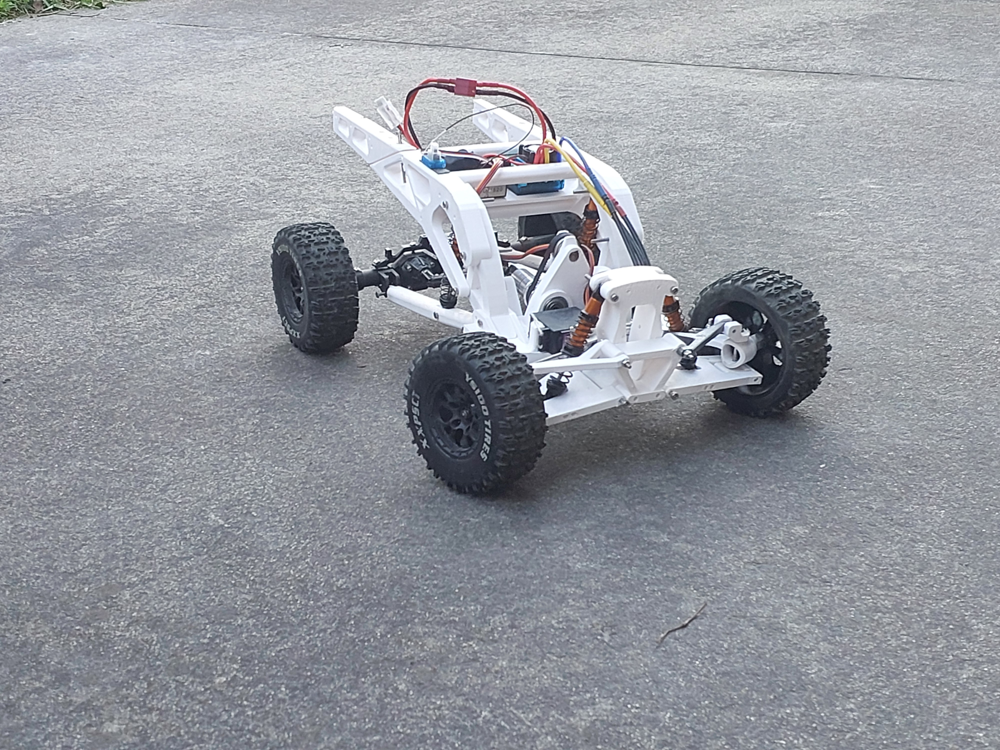 
  <em>Front corner views of the finished truck.</em>

  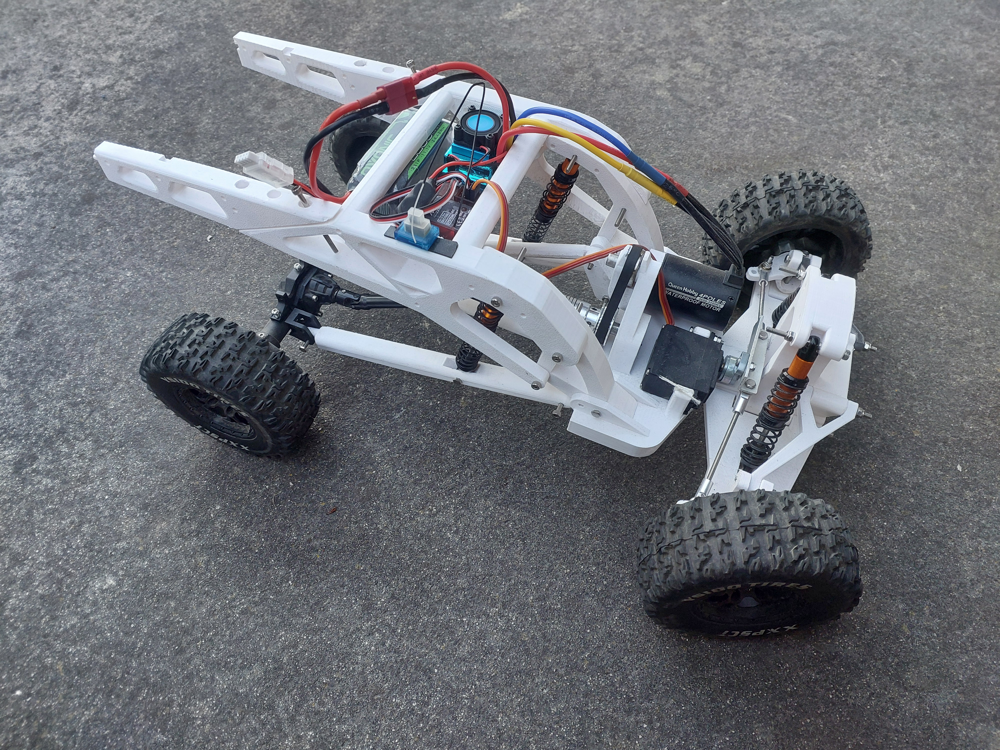
  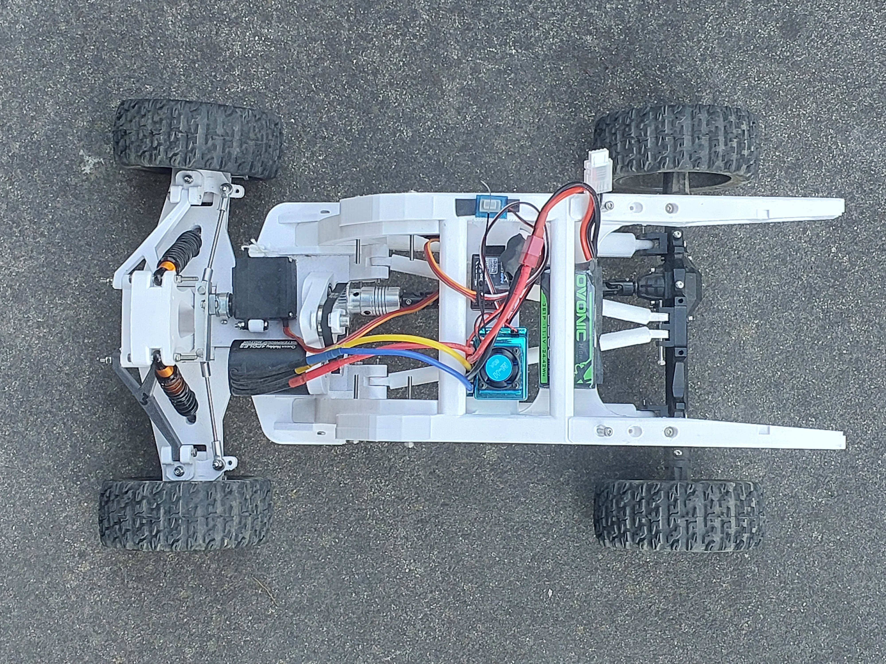 
  <em>Side and top views showing the layout.</em>

  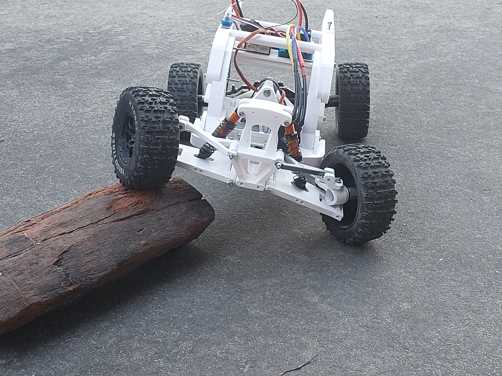
  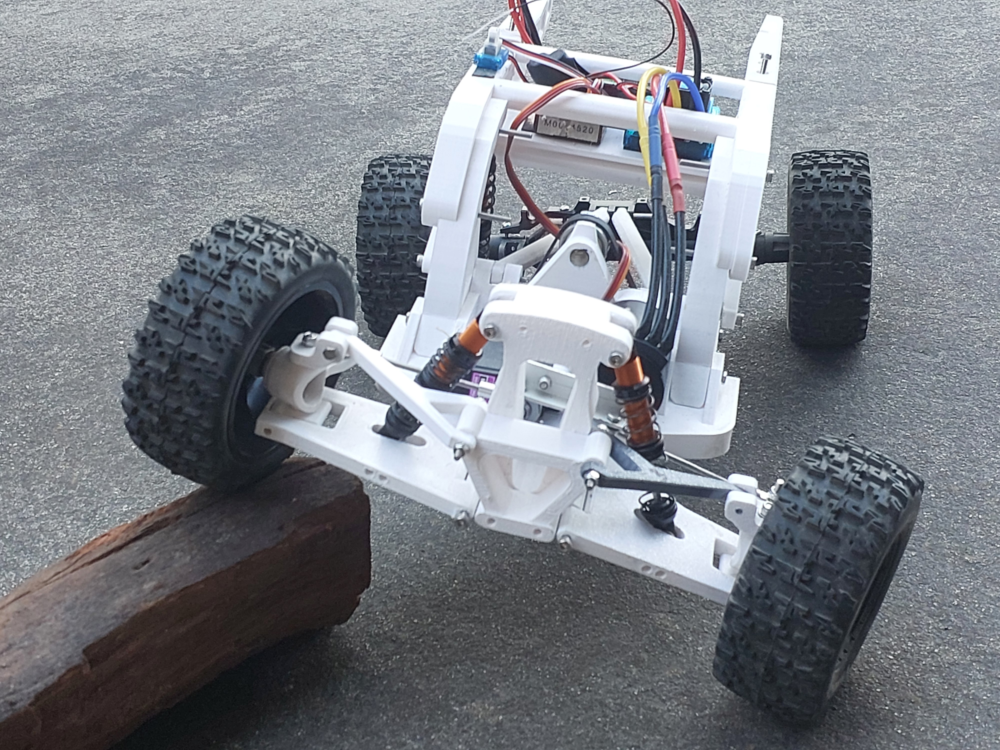 
  <em>The independent front suspension flexing over an obstacle.</em>

  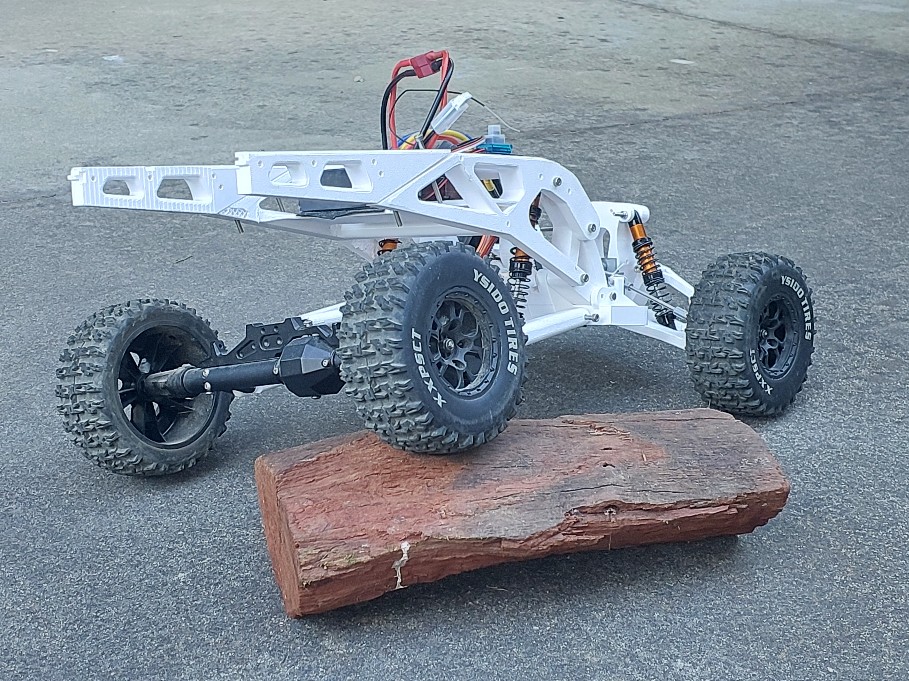
  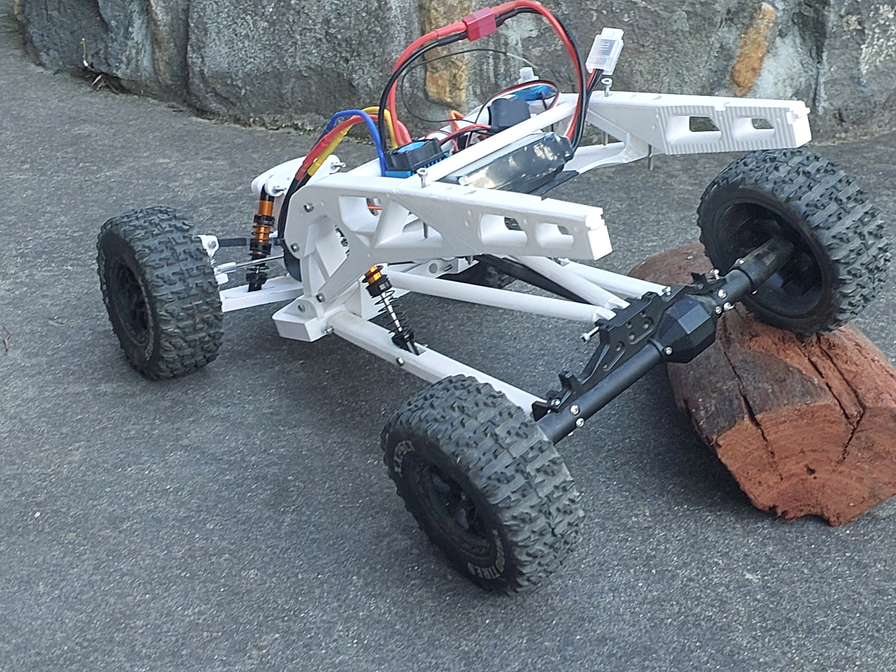 
  <em>The 4-link rear suspension over the same obstacle.</em>

  
  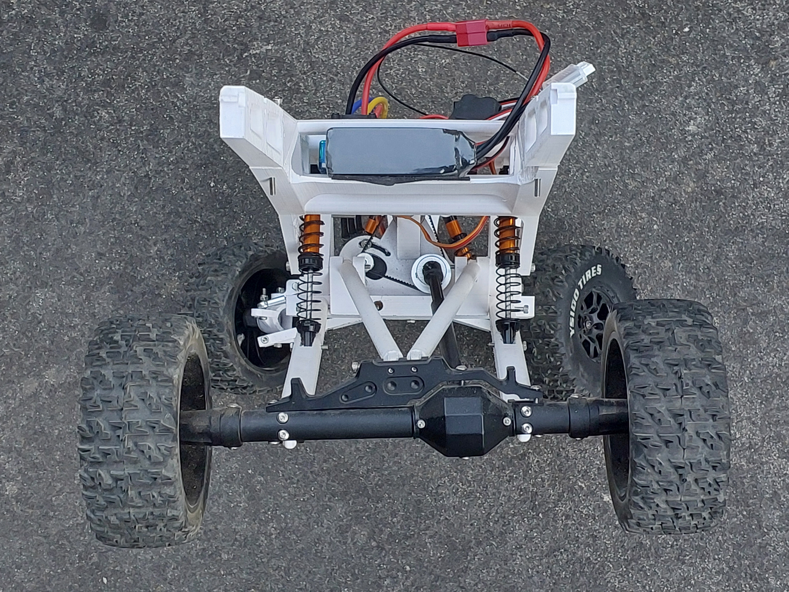
   
  <em>A close-up of the electronics, and a top-down view of the rear axle and drivetrain.</em>

