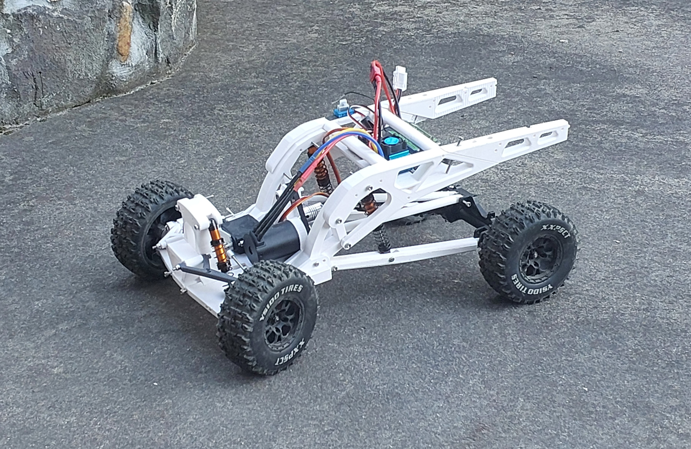

# [Project Title: e.g. Building an RC Car from Scratch]

*[One-line tagline: scale, type, and who or what it was built for.]*

[2 to 3 sentences: what you built, your target (budget, performance, durability), what it ended up costing and doing, and the main thing it taught you.]

   
  <em>[Caption: the finished car.]</em>

<!-- To add an uploaded video: drag the MP4 into the GitHub editor, then leave a blank line after the URL, and put the caption in a separate paragraph, like this:

https://github.com/user-attachments/assets/YOUR-ID

<em>Caption.</em>

-->

**At a glance**

- **Type:** [scale and type, e.g. 1/10 electric buggy, kit / modified / scratch-built]
- **Timeline:** [duration], roughly [hours] of work
- **Budget:** \$[target] target, about \$[actual] actual
- **Result:** [your headline result, with a number if you have one, e.g. 45 km/h, 20 minute run time]
- **Skills:** [3 to 5 skills, e.g. CAD, 3D printing, soldering, drivetrain tuning]

---

## Why I built it

[What you set out to do and why. Mention what you built before, such as the plane, and what was different this time.] The brief was: [your goals and constraints, in one or two sentences].

Early decisions that shaped the design:

- **[Decision 1, e.g. Motor and ESC]:** [options you weighed, what you chose, and why]
- **[Decision 2, e.g. Chassis or kit base]:** [options, choice, why]
- **[Decision 3, e.g. Battery or drivetrain]:** [options, choice, why]

---

## Design and dimensions

[What inspired the design, and what you needed it to do.]

   
  <em>[Caption: sketches, CAD screenshot or plan.]</em>

[How you chose the main dimensions and layout, and what trade-offs you made.]

- **Scale / type:** [ ]
- **Wheelbase / track width:** [ ]
- **Drivetrain:** [e.g. 2WD / 4WD, belt or shaft, gearing]
- **Suspension:** [ ]
- **Tyres:** [ ]
- **Weight:** [ ] g including battery

---

## [Component or stage 1: e.g. The chassis]

[What it needed to do, how you designed it, and how you built it.]

**Problem: [what went wrong].** [The cause, what you changed, and what happened afterwards.]

   
  <em>[Caption.]</em>

---

## [Component or stage 2: e.g. Suspension and drivetrain]

[Design reasoning and build, with any problem and fix.]

   
  <em>[Caption.]</em>

---

## Motor, electronics and radio

[How you chose and installed the electronics, and how long setup took. Include anything you found hard that would help the next builder.]

- **Motor:** [model, kV or turns]
- **ESC:** [amp rating]
- **Battery:** [cells, mAh, C rating]
- **Radio:** [transmitter and receiver]
- **Servo:** [type]

   
  <em>[Caption.]</em>

---

## Final touches

[Body, paint, decals, set-up and tuning, and final checks.]

---

## Budget

[One sentence on how you built the budget, your target, and your actual spend.]

- **[Category 1, e.g. Chassis and body]:** planned \$[ ], spent \$[ ]. [Note.]
- **[Category 2, e.g. Motor, ESC and battery]:** planned \$[ ], spent \$[ ]. [Note.]
- **[Category 3, e.g. Radio and servos]:** planned \$[ ], spent \$[ ]. [Note.]
- **[Category 4, e.g. Tools and consumables]:** planned \$[ ], spent \$[ ]. [Note.]
- **[Category 5, e.g. Repairs]:** \$[ ]

[Over or under by how much, where you saved money, and what you learned.]

---

## Results

[Test conditions: location, surface, weather, battery used.]

- **Performance:** [top speed, run time, acceleration, handling, with numbers if you have them]
- **Handling:** [how it drove, and what limited it]
- **Durability:** [crashes, rollovers, repairs, how many runs]

[2 to 3 sentences on how the results compare with your goals, and what they say about the design.]

[▶ Watch the run video on YouTube](https://www.youtube.com/watch?v=VIDEO_ID)

<em>[Caption.]</em>

---

## What I'd do differently

- [Change 1]
- [Change 2]
- [Change 3]

**Biggest lessons:** [two or three short lessons]

---

## Gallery

   
  <em>[Caption.]</em>

   
  <em>[Caption.]</em>

